## Let's start here

*Create and configure the AI agent*

## Goal

We'll start off with a process model that is designed for agentic orchestration but is currently using only an ad-hoc subprocess.

The main point of the exercise is to get a functioning process that uses an AI agent. For now, its functionality will be rather limited but we will expand it with each successive exercise.

Once finished your process should be slightly different, the important part being the lack of red X's (errors marked in the modeler):

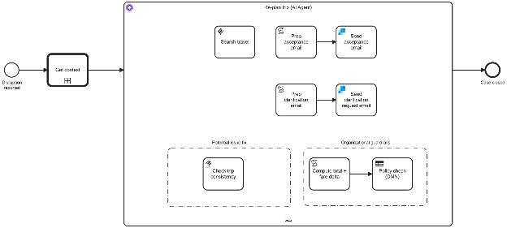

*E1_1 - Expected results*

## Step-by-step Instructions

### 1. Course materials

You should already have a starter BPMN model within your project folder. If you're not sure about your project folder, it should be labeled with your first name in the root of the Hub workspace. Please stick with the model given to you as we assign each participant a specific process ID.

You will update this model as we progress through the exercises.

### 2. Create an AI agent sub-process

The model can be left mostly intact. What we want to focus on in this exercise is creating our agent and configuring it appropriately.

In the starter model, you'll notice we have an ad-hoc sub-process. We need to change the element in order to use AI capabilities here.

1. Locate the ad-hoc sub-process labeled *Re-plan trip*.
2. Left click its border and find the wrench icon from the dialog box to change the element type (*figure 1.1*).
3. In the next pop-up dialog, locate the search bar and type in *AI Agent*. You should see *AI Agent Sub-process* listed in the search results. Click this option to transform your ad-hoc sub-process.

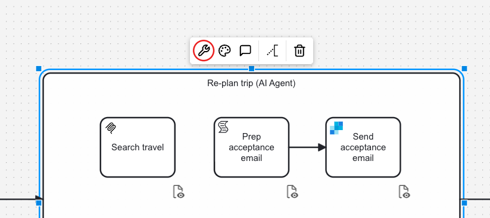

*Figure 1.1*

### 3. Configure the provider and model

Let's configure the provider and model portions of the agent. Configuring the provider tells the agent which LLM service to call and how to authenticate with it.

You'll notice a lot of the tasks within the subprocess have fields with this format `camunda.secrets.*`. The referenced data is already configured for you.

Make sure the sub-process is selected and that the *details* panel is expanded. If the panel is not showing the configuration information, make sure you have selected *Implement* mode (shown at the top left of the modeler screen) and have clicked the *Details* tab on the right side of the screen (*figure 1.2*).

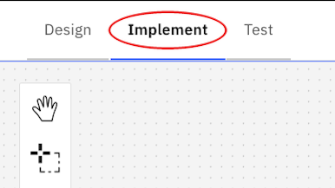 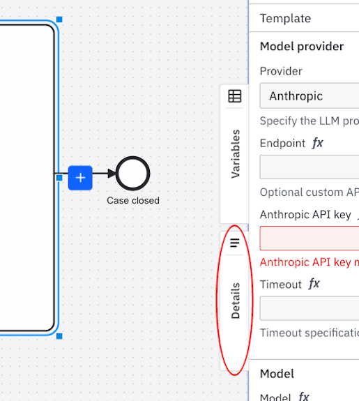

*Figure 1.2*

After you've done this, please fill in the following information in the *model provider* section so that it looks the same as the image shown. The values below can be copied directly.

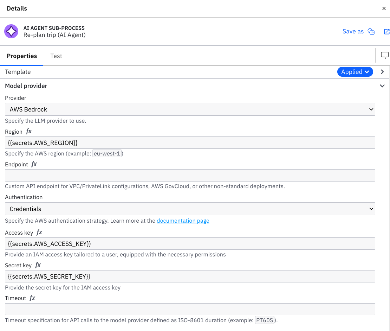

| Field | Value |
| :---- | :---- |
| Region | `camunda.secrets.AWS_REGION` |
| Access key | `camunda.secrets.AWS_ACCESS_KEY` |
| Secret key | `camunda.secrets.AWS_SECRET_KEY` |

Next, we need to configure the *model* section. This is where we specify the model and other related parameters.

Please fill in the following field:

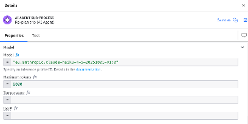

| Field | Value |
| :---- | :---- |
| Model | `eu.anthropic.claude-haiku-4-5-20251001-v1:0` |

### 4. Add system prompt

The system prompt defines the behavior and goal of the agent and instructs the LLM on how to act. It is what shapes how the agent reasons about which tools in the ad-hoc subprocess to call and when to stop.

We've created one already for this particular scenario we're building. Read the prompt and answer the following questions.

> **Questions**
>
> - Which sentence in the prompt stops the agent from inventing numbers?
> - What would happen without it?


**Sentence:** *"Never present a guessed or estimated number (e.g. a currency conversion you made up) as if it were a verified result."* It is backed up by *"do not silently substitute an estimate or guess and continue as if it had succeeded"* and by *"Use tools for all facts about this case"*.

**Without it:** when a tool fails or returns incomplete data, the agent could fill the gap with a plausible but invented price, fare delta or conversion rate. The re-plan would look complete, but the policy-limit check would rest on made-up numbers and a human reviewer could not tell.


Afterwards copy and paste it into the *System prompt* field.

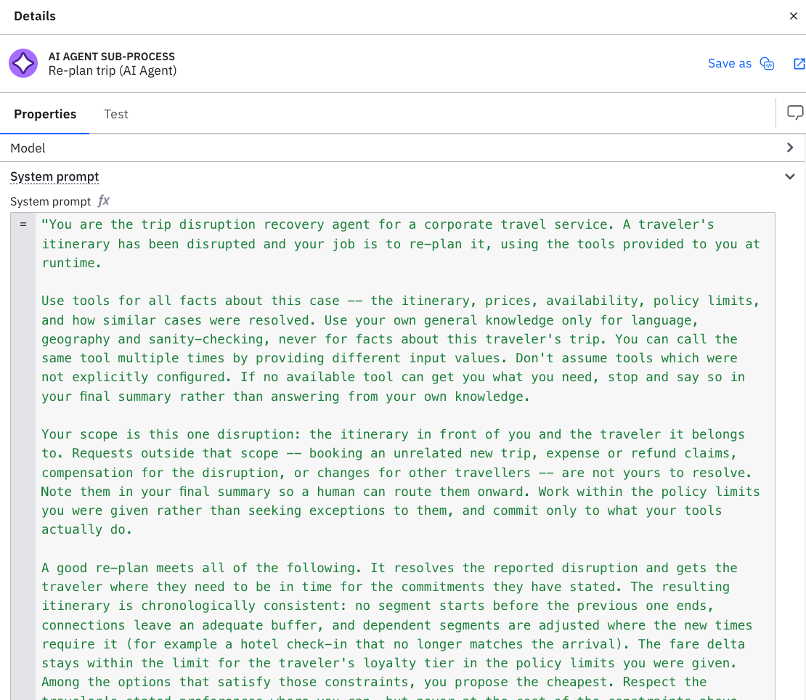


"You are the trip disruption recovery agent for a corporate travel service. A traveler's itinerary has been disrupted and your job is to re-plan it, using the tools provided to you at runtime. Use tools for all facts about this case -- the itinerary, prices, availability, policy limits, and how similar cases were resolved. Use your own general knowledge only for language, geography and sanity-checking, never for facts about this traveler's trip. You can call the same tool multiple times by providing different input values. Don't assume tools which were not explicitly configured. If no available tool can get you what you need, stop and say so in your final summary rather than answering from your own knowledge. Your scope is this one disruption: the itinerary in front of you and the traveler it belongs to. Requests outside that scope -- booking an unrelated new trip, expense or refund claims, compensation for the disruption, or changes for other travellers -- are not yours to resolve. Note them in your final summary so a human can route them onward. Work within the policy limits you were given rather than seeking exceptions to them, and commit only to what your tools actually do. A good re-plan meets all of the following. It resolves the reported disruption and gets the traveler where they need to be in time for the commitments they have stated. The resulting itinerary is chronologically consistent: no segment starts before the previous one ends, connections leave an adequate buffer, and dependent segments are adjusted where the new times require it (for example a hotel check-in that no longer matches the arrival). The fare delta stays within the limit for the traveler's loyalty tier in the policy limits you were given. Among the options that satisfy those constraints, you propose the cheapest. Respect the traveler's stated preferences where you can, but never at the cost of the constraints above. If you cannot satisfy all of them, say plainly which constraint you could not meet and why. If you need to ask the traveler a clarifying question (e.g. an ambiguity, a missing detail, a preference or trade-off) before you can proceed, you MUST call the tool that sends the traveler a clarifying question -- never pose the question directly in your own response text instead of calling that tool. IMPORTANT -- the traveler's replies (from the tools that contact the traveler) are short, generic acknowledgements. They confirm intent (e.g. agreement, willingness to proceed) but do NOT restate or answer the specific question you asked -- they will never contain concrete details like names, dates, or emails you're still missing. If your question needed a factual answer (e.g. passenger names, a choice between explicit options) and the reply doesn't contain that fact, do NOT invent or guess the missing detail and do NOT silently proceed as if it was answered -- hand the case to a person so they can supply it. IMPORTANT -- if any tool call returns an error, an empty result, or a result that doesn't match what you expected (e.g. a missing field, an unparseable value): do not silently substitute an estimate or guess and continue as if it had succeeded. Either retry the tool once with corrected input if the problem was likely your own input, or stop and clearly state in your final summary which step failed and why, so a human can intervene. Never present a guessed or estimated number (e.g. a currency conversion you made up) as if it were a verified result. When you cannot make further progress on your own, hand the case to a person rather than writing a final answer. Reserve your final answer for cases where you have a resolution to propose, or where the case cannot be resolved by anyone. Once you have finished calling tools, write a plain-language final answer for the human reviewing this case: a clear summary of what was found and done, any open questions or missing information, and the proposed resolution. Do not use XML tags or other markup to separate your reasoning from your answer. Never end the conversation mid-sentence, and never end it without either calling a tool or writing a final answer."


### 5. Add user prompt

Next we need to add the user prompt. The user prompt is the actual request sent to the LLM. It is the initial ask or a follow-up in a feedback loop. It's added to conversation memory and supports FEEL expressions.

Please read and paste the following user prompt into the *User prompt* field.

> **Question**
>
> Why would you use process variables in the user prompt, and not in the system prompt?


The system prompt is static: it defines the role, rules and behavior, and is the same for every process instance. The user prompt is the actual request, so it carries the data that changes per case (`problemDescription`, `tripDisruption`, `policyRules`, and `tripJudgeReason` after a rejected attempt).

Keeping data out of the system prompt keeps it reusable and easy to maintain, and separates instructions from case data. It also lets a feedback loop add a new user prompt with the rejection reason without changing the agent's rules.


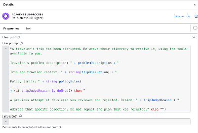


"A traveler's trip has been disrupted. Re-weave their itinerary to resolve it, using the tools available to you. Traveler's problem description: "
  + problemDescription
  + " Trip and traveler context: "
  + string(tripDisruption)
  + "Policy limits: "
  + string(policyRules)
  + (if tripJudgeReason is defined() then
      " A previous attempt at this case was reviewed and rejected. Reason: "
        + tripJudgeReason
        + " Address that specific objection. Do not repeat the plan that was rejected."
    else "")


### 6. Complete configurations

Let's fill in the rest of the configurations. First, the *Memory* section configures the agent's short-term conversational memory, which is what the agent remembers across its tool-calling loop and any feedback loops.

The agent context specifically is the connector's conversation state. It is the running record of the agent's conversation with the LLM that gets passed back into each subsequent LLM call so the agent remembers what's happened.

Configure the memory section as shown:

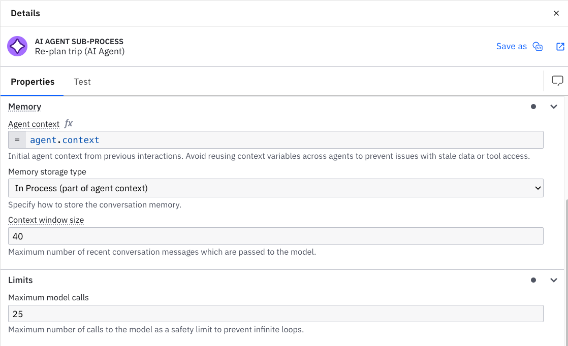

The response and output mapping sections are the last ones we'll fill in. The *Response* section configures the response format. It is how the model should return its output (text or JSON) and how the connector processes the returned response.

For output mapping, we just need to set the result variable. This contains the LLM response so downstream elements can use the result or feed the context back in for a follow-up call. Please make sure the *response* is the same as the image below.

> **Question**
>
> When would you use JSON rather than Text?


Use **Text** when the result is meant to be read by a person, like the final summary of this exercise. Use **JSON** when downstream elements must read individual fields from the answer, for example to map them into process variables or to use them in gateway conditions. JSON gives a predictable structure, text does not.


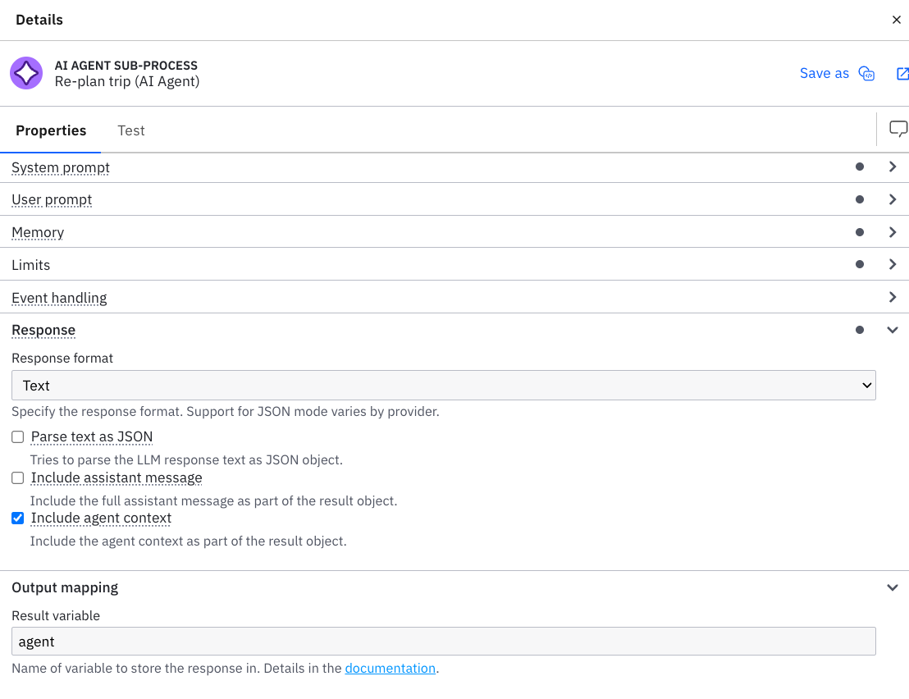

## Testing

Next we need to test that we've set up everything correctly. To do that, we'll use Test mode.

1. Currently you should be in *Implement* mode. Click where it says *Test* next to it at the top of the screen.
2. We'll need to deploy the diagram before we're able to run it here. Click the blue button *Deploy*.

    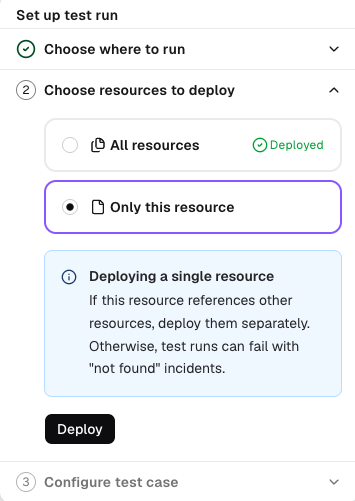

3. After the model has been deployed, you should see the *Configure test case* window. Here is where we can say what we're asserting and what the data should be. In this case, the data should be mostly filled out for you already, but we need to make some changes. Please click *Edit variables*.

    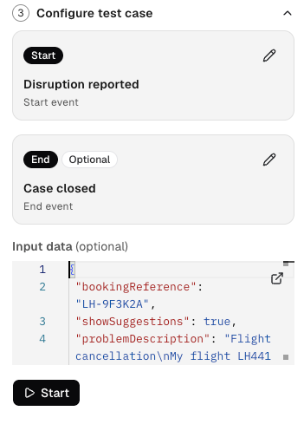

4. Enter your name and email after *contactPersonName* and *contactPersonEmail*. Make sure it's a valid email address as we'll be checking this later on.

    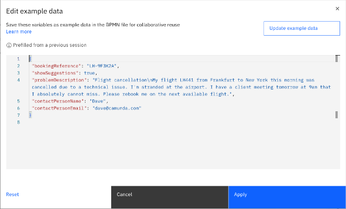

5. Click *Apply* and the test case should run. Now click the Process instance key to open Operate and monitor the execution.

    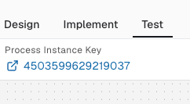

If everything worked correctly, after some time, you should see that the process has reached the end event without error.

> **Question**
>
> What tools did your agent use in your execution?


It varies between runs, as the agent decides which tools to call and how often (the same tool can be called several times with different inputs). To see it, open the process instance in Operate and look at the elements that were executed inside the AI agent sub-process in the instance history.


Also, have a look at your inbox for the email address you used for the test case. If you see an email from [ilt-training@camunda.com](mailto:ilt-training@camunda.com), nice job, you have completed the exercise correctly.

## Additional resources

- Ad-hoc subprocesses: [https://docs.camunda.io/docs/components/modeler/bpmn/ad-hoc-subprocesses/](https://docs.camunda.io/docs/components/modeler/bpmn/ad-hoc-subprocesses/)
- AI Agent Sub-process connector: [https://docs.camunda.io/docs/components/connectors/out-of-the-box-connectors/agentic-ai-aiagent-subprocess/](https://docs.camunda.io/docs/components/connectors/out-of-the-box-connectors/agentic-ai-aiagent-subprocess/)
